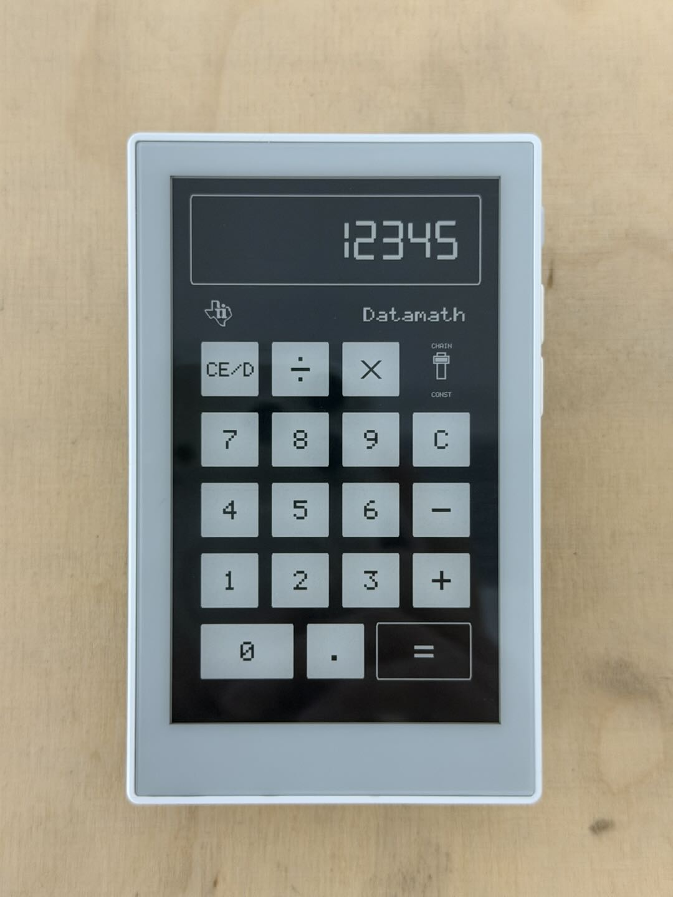

# reTerminal Sticky Calculator

An ESP-IDF v5.4 calculator demo for the [Seeed Studio reTerminal Sticky](https://www.seeedstudio.com/sticky/).

<div align="center">
  
</div>

It provides two 480 x 800 portrait E-Ink calculator pages:

- **TI-2500 Datamath** - a retro calculator inspired by the 1972 TI-2500 Datamath.
- **Modern Calculator** - a clean modern calculator with history and expression display.

## Features

- TI-2500 Datamath-inspired calculator with CHAIN / CONST behavior and 8-digit display rules
- Modern calculator with expression display, Delete, percentage, sign toggle, thousands separators, and RAM history
- Touch input and short buzzer feedback
- Either UP or DOWN cycles between the Datamath and Modern Calculator pages
- Battery percentage and charging-state logging
- 1-bit black-and-white E-Ink refresh, with periodic full refreshes to limit ghosting
- Automatic SSD1677 / SSD2677 controller detection in the same firmware
- AI short press clears the active calculation and fully refreshes the page
- AI long press (about one second) powers the device off; wake-up uses a 500 ms hold confirmation after board initialization
- Cold boot shows the calculator wallpaper and enters Deep Sleep until the AI button is held

## Requirements

- reTerminal Sticky
- ESP-IDF v5.4
- USB-C cable

The target is `esp32s3`, with 32 MB flash and Octal PSRAM enabled.

## Firmware download

Download the merged [Calculator v2.0.0 firmware](https://github.com/Lukilyy/reterminal-sticky-calculator/releases/download/v2.0.0/reterminal-sticky-calculator-v2.0.0.bin) from [GitHub Releases](https://github.com/Lukilyy/reterminal-sticky-calculator/releases/tag/v2.0.0).
The same firmware supports SSD1677 and SSD2677 displays.

Flash the complete BIN at **0x0**, using ESP32-S3, DIO, 80 MHz and 32 MB flash settings:

```bash
python -m esptool --chip esp32s3 --port COM6 --baud 460800 write_flash --flash_mode dio --flash_freq 80m --flash_size 32MB 0x0 reterminal-sticky-calculator-v2.0.0.bin
```

Replace `COM6` with your device's serial port.

## Build and flash

Set up ESP-IDF v5.4, then clone the repository:

```bash
git clone https://github.com/Lukilyy/reterminal-sticky-calculator.git
cd reterminal-sticky-calculator
idf.py set-target esp32s3
idf.py build
idf.py -p COM6 flash monitor
```

Replace `COM6` with the Sticky serial port. Use `Ctrl+]` to leave the serial monitor.

After flashing, the wallpaper is shown and the device sleeps. Hold the AI button until the startup beep to start Calculator. Wake-up includes board initialization followed by a 500 ms hold confirmation.

## Controls

| Input | Action |
| --- | --- |
| Touch | Enter calculator keys on the active page |
| UP / DOWN | Cycle between Datamath and Modern Calculator |
| AI short press | Clear calculation and fully refresh the active page |
| AI long press | Power off or wake the device |
| Modern Calculator history icon | Open recent calculation history |

## Project layout

```text
main/
|-- app/       Calculator state, input routing, display task, and history
|-- assets/    Compiled Inter glyphs, TI logo, and power-off wallpaper
|-- board/     Sticky power and shared I2C setup
|-- devices/   E-Ink, touch, buttons, buzzer, battery, charger, sleep, and SD support
`-- ui/        Canvas plus Datamath, Modern Calculator, and wallpaper views
assets/        Wallpaper source image and Inter license
tools/         Reproducible wallpaper and font conversion scripts
components/    BQ27220, GT911, button, and SSD1677 / SSD2677 display components
```

## Credits and third-party notices

- Built with [Espressif ESP-IDF](https://github.com/espressif/esp-idf) v5.4.
- Physical-button input uses the bundled [espressif/button](https://github.com/espressif/esp-iot-solution/tree/master/components/button) component (v4.1.6), licensed under Apache License 2.0. Its license is retained at [`components/button/license.txt`](components/button/license.txt).
- The modern Calculator bitmap glyphs are generated from [Inter](https://github.com/rsms/inter). Inter is licensed under the SIL Open Font License 1.1; its license is retained at [`assets/INTER-OFL-1.1.txt`](assets/INTER-OFL-1.1.txt).
- Other bundled components retain any license and attribution notices distributed with their own files. This project's MIT license does not replace those terms.

## Trademarks

The TI-2500 Datamath page is an unofficial design study inspired by the 1972 calculator. TI, Datamath, and related marks belong to their respective owners. This project is not affiliated with, endorsed by, or sponsored by Texas Instruments.

## License

The original source code and original project assets in this repository are licensed under the [MIT License](LICENSE). Third-party components, the Inter font data, and third-party trademarks are excluded from that grant and remain subject to their own notices and terms above.
